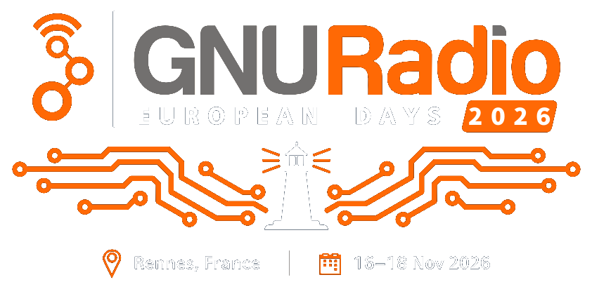
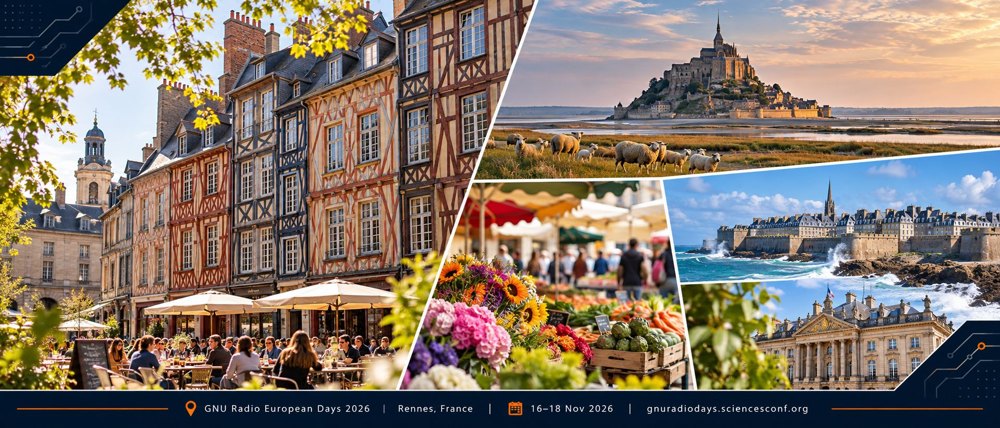

<p align="center"></p>

# GREMLIN — Finding What Machines Don’t Tell You

[](https://doi.org/10.5281/zenodo.24059478)

_Passive RF diagnostics and machine-state inference at FAIR_

**European GNU Radio Days 2026**, Rennes, France — Monday, 16 November 2026, 15:10, Methodology session; a
10-minute show-and-tell. Alexander Krimm, Simon Lebedev, Ralph J. Steinhagen, Horst Welker, GSI/FAIR Darmstadt.

GREMLIN explores how much can be learned about complex small- and large-scale infrastructure and technical systems
from the emitted RF signals they already produce.

This short show-and-tell presents ongoing work at FAIR as part of the EU iRIS project, combining high-rate RF signal
acquisition, modern C++/DSP, time-series replay and machine-learning-assisted inference to detect hidden states,
anomalies and correlations across distributed equipment. The emphasis is practical: turning existing signals into
useful diagnostics using maintainable, software-defined instrumentation based on GNU Radio 4.0 and related tools.

Project page: [https://fair-acc.github.io/gremlin/](https://fair-acc.github.io/gremlin/) · funded by the European Union's Horizon Europe programme,
grant agreement No. 101275935 ([iRIS](https://cordis.europa.eu/project/id/101275935)).

## The deck

`talk.md` is a [gr4-present](https://github.com/RalphSteinhagen/gr4-present) deck (`entry:` in `index.yml`): twelve
slides and the references, then backups. The arc: every device has an RF fingerprint (the EMI picture, a testbed
spectrogram, where in the spectrum) → why GSI/FAIR does this → why it matters beyond accelerators (the 2026
refrigeration attacks) → "think this is easy … ?" (NILM as a Sudoku: four devices, today's solver, ageing, hundreds
of devices, the same inverse problem in other domains) → "help us to catch … GREMLINs", which stays up during the
questions. Speaker notes are in each slide's `:::notes`.

```bash
./serve.sh            # serves this folder on :8000 and opens the public viewer on it
./serve.sh -p 8010    # another port; --no-open only serves
```

The viewer is the copy the live slides use (`../viewer/<viewer:>`, served on `:8080`), or a local gr4-present
WASM-Minimal build, or the public [minimal viewer](https://ralphsteinhagen.github.io/gr4-present/minimal/?presentation=http://localhost:8000); it reads the deck
from the local server. Chrome asks once for *Local network access* to `localhost`; allow it (the lock icon in the
address bar). *Load* in the viewer's side menu (`Ctrl+O`) opens the folder from disk instead; tick *follow edits* to
reload on every change. Present fullscreen (F11): the layout is exact at 16:9.

## Licence

Slides: CC-BY-4.0, R. J. Steinhagen, GSI/FAIR.<br>
Third-party pictures keep their own terms (`media/CREDITS.md`);

<p align="center"></p>
