# {#title master=title}

:::layout
emblem: figures/iris-eye.svg
eu_flag_box: figures/Flag_of_Europe.svg
logo: media/gnuradiodays-2026-banner-cutout.webp
fairgsi: figures/logos-dark.svg
:::

:::place
maintitle: 0.058 0.060 0.640 0.160
subline: 0.058 0.180 0.640 0.060
:::

:::maintitle {size=27pt}
[GREMLIN]{size=200%} [Finding What Machines Don't Tell You]{size=78%}
:::

:::subline {size=20pt}
*Passive RF diagnostics and machine-state inference at FAIR*
:::

:::authors
[**Alexander Krimm, Simon Lebedev, Ralph J. Steinhagen, Horst Welker, GSI/FAIR Darmstadt, Germany**]{colour=#ffff00}
:::

:::funding {size=90%}
This project has received funding from the European Union's Horizon Europe 
research and innovation programme under grant agreement No. 101275935 
([iRIS – Intelligent Research Infrastructure Sustainability](https://cordis.europa.eu/project/id/101275935)).
:::

:::notes
(≈ 30 s) Finding what machines don't tell you: every electrical device leaks a characteristic electromagnetic signature, and GREMLIN turns that noise into a diagnostic layer for a whole facility — where the power goes, which devices are about to fail — from essentially one sensor on the mains feed.

The RF story first, then why we do it, why it is harder than it looks — and why we are hiring. I'm Ralph Steinhagen, and this is our work is with Alex, Simon and Horst at GSI/FAIR — and perhaps soon also you.
:::

# {#gremlin master=title-logo}

:::layout
gremlin: figures/GREMLIN_logo_dark.svg
fairgsi: figures/logos-dark.svg
transition: glitchlong
duration: 3
:::

:::place
grlogo: 0.706 0.024 0.277 0.101
:::

:::grlogo

:::

:::tagline {size=110%}
[**one RF EMI sensor → many devices: what runs, what drifts, what is likely about to fail** open hardware & software, GNU Radio 4.0-powered: [fair-acc.github.io/gremlin](https://fair-acc.github.io/gremlin/)]{colour=#ffff00}
:::

:::notes
GREMLIN is the 'GReen Energy Monitoring for Large INfrastructure': one RF sensor, and a lot of GNU Radio 4, open hardware and open source under the hood that does the rest.
:::

# Every electrical device has an RF Fingerprint one sensor at the mains feed sees every device {#emi}

:::place
annot: 0.222 0.041 0.767 0.409
annot_a: 0.791 0.048 0.200 0.292
annot_b: 0.544 0.032 0.191 0.207
caption: 0.302 0.717 0.500 0.090
cell_1: 0.14764 0.40577 0.23491 0.27000
cell_2: 0.38255 0.40577 0.23491 0.27000
cell_3: 0.61745 0.40577 0.23491 0.27000
cell_4: 0.14764 0.65633 0.23491 0.27000
cell_5: 0.38255 0.65633 0.23491 0.27000
cell_6: 0.61745 0.65633 0.23491 0.27000
:::

:::annot
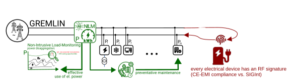
:::

:::step
:::annot_a
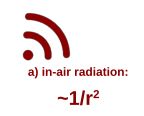
:::

:::annot_b
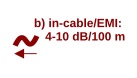
:::

:::caption {centre_upper font=hand size=300%}
"somebody's noise is somebody else's signal"
:::

:::step {in=crt dur=1}
:::cell_1 {bottom}
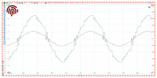
:::

:::step {in=crt dur=1 after=0}
:::cell_2 {bottom}
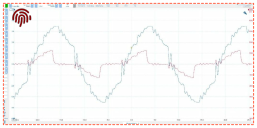
:::

:::step {in=crt dur=1 after=0}
:::cell_3 {bottom}
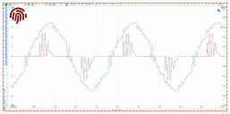
:::

:::step {in=crt dur=1 after=0}
:::cell_4
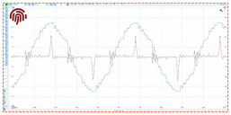
:::

:::step {in=crt dur=1 after=0}
:::cell_5
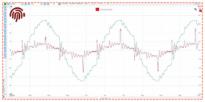
:::

:::step {in=crt dur=1 after=0}
:::cell_6
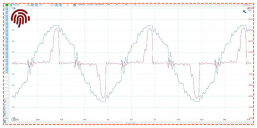
:::

:::notes
Anything with switching semiconductors — a switch-mode supply, a motor or LED driver — emits interference as a by-product of how it works:
switching frequency, harmonics, transients. These are their RF fingerprints: characteristic for the device type and for what it is doing, 
and different for every unit, even of the same model, because the input-filter parts vary from piece to piece and drift as they age.

RF and Radio people know it from signals intelligence: no two transmitters are alike.

[click] It travels two ways: radiated, which falls off very quickly with distance, and conducted that can travel over kilometric distances along the mains wiring. 
It loses only a few dB per hundred metres. So one sensor at the feed sees the sum of every device on the line — and because the signatures are distinct, you can unmix or 'disaggregate' them.
That is non-intrusive load monitoring, NILM, in a nut-shell.

My favourite adage from my years in instrumentation is: "Somebody's noise is somebody else's signal" what EMC engineers work to suppress, we mine.

[click] Six devices, six current waveforms, six distinct fingerprints.
:::

# Every electrical device has an RF Fingerprint … clearly identifiable in frequency-domain (measurement) {#testbed}

:::layout
transition: cut
:::

:::place
annot: 0.222 0.041 0.767 0.409
wide_lower: 0.000 0.445 1.000 0.470
bottom_line: 0.208 0.900 0.610 0.085
:::

:::annot
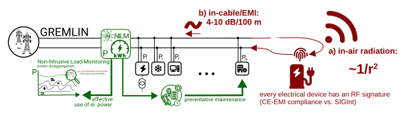
:::

:::wide_lower
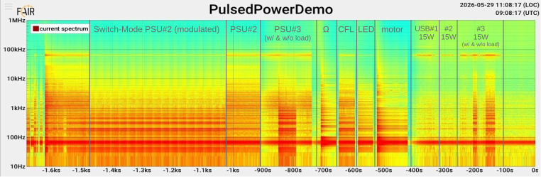
:::

:::bottom_line {centre size=80%}
*"if you can visually see this, there's a better chance of teaching a machine to detect and classify it"*
:::

:::notes
Here is some real data from our testbed, acquired and turned into spectra by GNU Radio 4: Frequency up, time across: each band is a device — switch-mode supplies, a motor, and the faint ones are different USB chargers and/or with and without load

If you can see it, you can teach a machine to classify it. The rest is learning to read it reliably — and that is the talk.
:::

# EMI Signature and Compliance our signal is in the compliance/noise spectrum {#emi-compliance}

:::place
picture: 0.251 0.273 0.546 0.727
inset_wide: 0.5089 -0.0006 0.4943 0.3035
callout: 0.344 0.735 0.400 0.080
mascots: 0.617 0.681 0.130 0.165
:::

:::picture
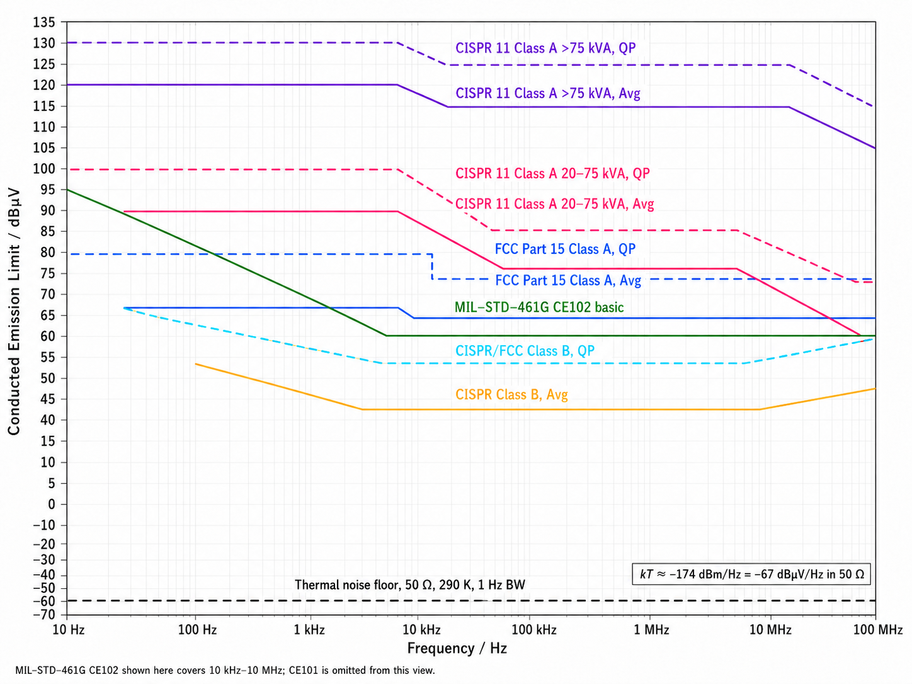
:::

:::inset_wide
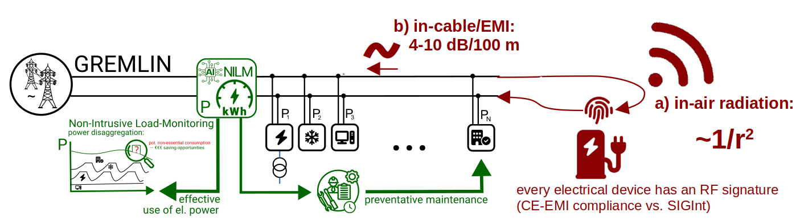
:::

:::callout {size=150%}
**← GREMLIN territory →**
:::

:::mascots
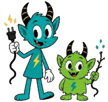
:::

:::notes
For the RF people: this sits in the conducted-emission spectral limits — Class A industrial, Class B residential — are the lines EMC engineers work to stay under. 
Switching frequencies, their harmonics and the transients usually sit right there. That is GREMLIN territory: what compliance wants to suppress is the information gold that we measure.
:::

# Why we do this at GSI/FAIR three disciplines, one sensor on the feed — and everyone can use it {#why}

:::place
pillars: 0.030 0.217 0.460 0.640
grlogo: 0.030 0.900 0.193 0.070
onnx: 0.242 0.900 0.150 0.070
plot: 0.578 0.135 0.325 0.430
numbers: 0.510 0.555 0.460 0.300
:::

:::pillars
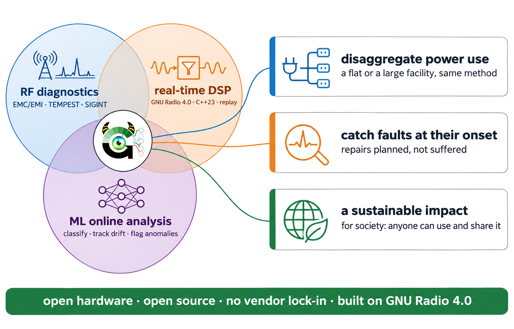
:::

:::grlogo

:::

:::onnx

:::

:::plot
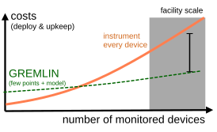
:::

:::numbers {size=88% notes=off}
**one DAQ instead of instrumenting thousands of devices** — it says where to act, operations act

**at FAIR:** a few % efficiency drift on MW-class converters ≈ 20 GWh/year; an idle day at SIS18 > 120 k€ & lost time for science!

**iRIS cost–benefit analysis (a separate work package):** the research-infrastructure case pays back ≈ 22 : 1 over eight years, as accelerator downtime is costly; cybersecurity ≈ 1.6 : 1[^iris]
:::

:::notes
You probably asking yourself: "why does an accelerator lab do this?" GREMLIN sits where three things we already do meet: 
RF diagnostics, real-time signal processing — what GNU Radio 4 is for — and machine learning that runs online on the stream. 
Out of that: prove of network operator compliance, disaggregated power use, faults caught at their onset, 
so repairs are planned rather than suffered, and open hardware and software that anyone can use and share.

[click] The economics: one DAQ on the feed instead of instrumenting thousands of devices. A few percent drift on MW-class converters is of the order of twenty gigawatt-hours a year, and 
an idle day at our SIS18 synchrotron, costs more than about 120 k€; measuring them is what iRIS funds. 
Our iRIS colleagues at the University of Milan and CERN put the research-infrastructure case at about twenty-two to one over eight years, mostly because accelerator downtime is so expensive.

(If asked: Within iRIS, GREMLIN is the operational-phase pillar, next to excavation-material classification and surface re-greening across the facility lifecycle.)
:::

# Why it matters beyond Accelerators Infrastructure/Controllers can be told to lie — the electrical network wire cannot {#society}

:::place
haguenau: 0.05 0.135 0.436 0.6
paris: 0.48 0.135 0.489 0.6
line: 0.05 0.720 0.940 0.15
sketch: 0.48 0.135 0.489 0.6
:::

:::haguenau
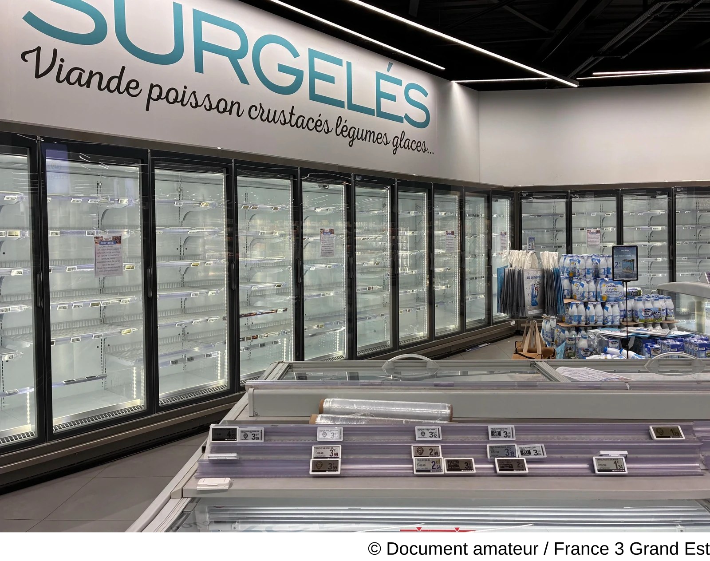
:::

:::paris
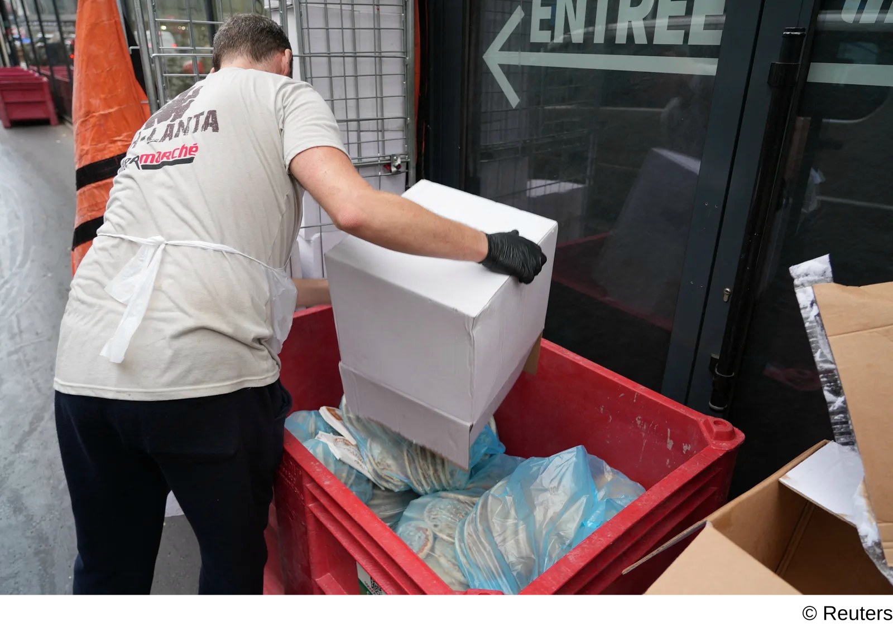
:::

:::line {notes=off}
**12 Oct 2026: ~700 French supermarkets**[^ap]**, fridges driven to +50 °C through internet-exposed controllers**[^certfr] 
**2 Nov 2026: three plasma stores of the French blood service, caught by its alarms**[^efs] 
**           after: many similar incidences in Sweden and across Europe ...** 
[iRIS work package's cost–benefit analysis puts cybersecurity case at a benefit-to-cost ratio (BCR) ≈ 1.6 per site and **250–750 M€/yr avoided EU-wide at 5 % adoption (only)**]{size=caption}[^iris]
:::

:::step
:::sketch

:::

:::notes
This is why it matters outside our small world: on the morning of the thirteenth of October: overnight, the refrigeration controllers of about seven hundred French supermarkets were told to lie 
— setpoint from minus eighteen to plus fifty, defrost heaters forced on. Spoiled stock, losses in the tens of millions. 
Three weeks later the same was tried on plasma stores of the French blood service; there, the alarms caught it. The same pattern has been repeated in Sweden and other parts of Europe.

[click] The controller is the attack surface because it is networked software; once taken over, its display says whatever the intruder set. 
GREMLIN is the opposite: one passive sensor on the mains feed — nothing to patch, nothing to hack. 
It sees heaters on at the wrong time and compressors that stopped cycling, and would have raised the alarm at 01:40. We have not run it on a supermarket — but the physics is visible whether or not the controller admits it. Our iRIS colleagues' analysis puts this case at about 1.6 to 1 per site.

(If asked about other cases: the same analysis found the *fire-prevention* case does not pay off — a rare event against a front-loaded capex — so we do not claim it. 
The research-infrastructure case is the strong one, about 22 to 1.)

:::

# Think this is easy … ? four devices, five harmonics each — you only ever see their sums {#sudoku-4}

:::layout
duration: 1
:::

:::place
fig: 0.030 0.130 0.940 0.800
:::

:::fig
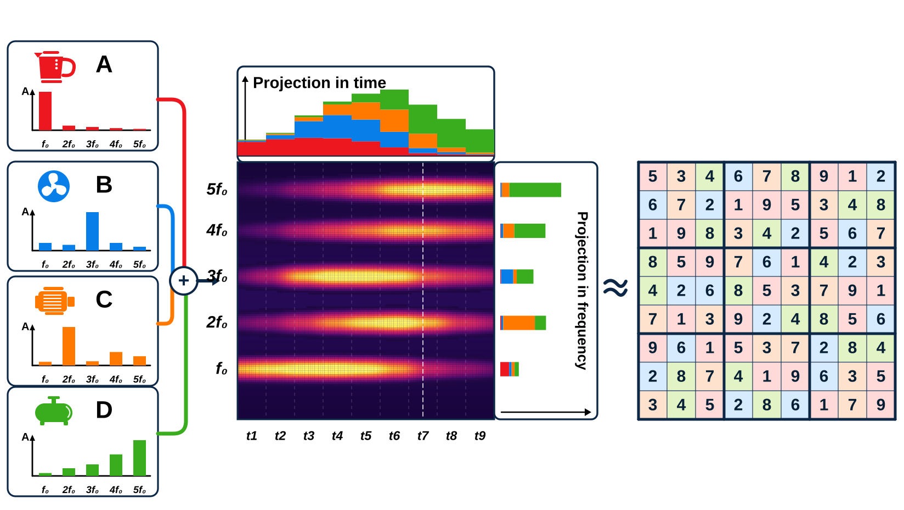
:::

:::notes
So — you think this is easy? Four devices — a kettle, a fan, a motor, a compressor — each with its own pattern of harmonics, its digits.
On the wire they add up into one spectrogram, and all you ever see are the sums: the projection in time and the projection in frequency.
Unmixing is kind of a Sudoku: the signatures and the physics are the rules, the projections the clues, the solved grid the disaggregation.
For a handful of devices this *is* easy — that is the next slide.

:::

# How we solve the easy one today EMI-driven feature extraction and device classification {#nilm-features}

:::layout
icons: figures/icons-domestic-industry-warn.svg
:::

:::place
picture: 0.030 0.155 0.940 0.605
text: 0.050 0.780 0.800 0.17
:::

:::picture
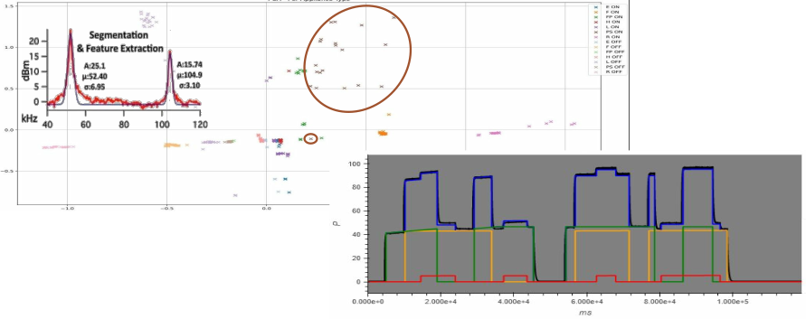
:::

:::text {notes=off}
- Very basic classification, only peaks' position, width, and height[^gupta]
  - **works adequately for a limited number of devices (N < ~20, largely kNN-based)**
  - **presently: primary limitations are ML training costs – O(n²) for n devices – & Time-Series-DB integration** *(ideas for better model architectures exist but need to be followed up)*
:::

:::notes
How we solve the easy puzzle today: a deliberately simple classifier — peak position, width and height of the EMI lines — that works for under about twenty devices.
The limits: the training cost grows quadratically with the number of devices, and we need a high-performance time-series database to replay and label data at scale.
We are handling about 250 MB/s read/writes during operation, but want to achieve a replay performance of at least 3 GB/s or more. Then come device ageing and scale.

This is the part where we need help and plan to boost our team.
:::

# Think this is easy … ? … until they age: the digits drift {#sudoku-drift}

:::layout
transition: fade
duration: 1
:::

:::place
fig: 0.030 0.130 0.940 0.800
:::

:::fig

:::

:::notes
Until they age: same puzzle, but a five has become five-point-five, a four four-point-seven-five — and next month they will have moved again. 
That is real: capacitors, IGBTs and DC-DC converters change their conducted emissions as they age. 
It is the opportunity — an early warning, predictive maintenance from the same sensor — and the difficulty:
the solver must tolerate the drift. The honest open questions: false alarms, missed faults, and how much lead time we really get.

(If asked: in signal-processing terms the dictionary drifts; we benchmark against classical spectrum analysis and ground truth, not against faith.)
:::

# Think this is easy … ? … hundreds of devices over dozens of topologies {#sudoku-16}

:::layout
transition: fade
duration: 1
:::

:::place
fig: 0.0336 0.1543 0.8764 0.7441
opener: 0.0250 0.1311 0.2658 0.0718
decay: 0.6375 0.0044 0.1577 0.3243
rdecay: 0.7764 0.0056 0.0175 0.0244
eht: 0.0250 0.7778 0.1007 0.2423
reht: 0.1070 0.7789 0.0175 0.0244
chirp: 0.8071 0.0044 0.1904 0.3242
rchirp: 0.9788 0.0056 0.0175 0.0244
schottky: 0.5375 0.3444 0.1798 0.3121
rschottky: 0.6985 0.3456 0.0175 0.0244
radiography: 0.7276 0.3444 0.1231 0.3118
rradiography: 0.8320 0.3456 0.0175 0.0244
phasespace: 0.1483 0.7778 0.1531 0.2420
rphasespace: 0.2826 0.7789 0.0175 0.0244
emitterid: 0.8610 0.3444 0.1365 0.3118
remitterid: 0.9788 0.3456 0.0175 0.0244
rfi: 0.6768 0.6000 0.3201 0.3990
rrfi: 0.9782 0.6903 0.0175 0.0244
passiveradar: 0.3239 0.7778 0.1279 0.2422
rpassiveradar: 0.4330 0.7789 0.0175 0.0244
microdoppler: 0.4743 0.7778 0.1350 0.2422
rmicrodoppler: 0.5906 0.7789 0.0175 0.0244
:::

:::fig

:::

:::step {in=grow dur=0.5}
:::opener

:::

:::step {in=grow dur=0.4 after=0.0}
:::decay
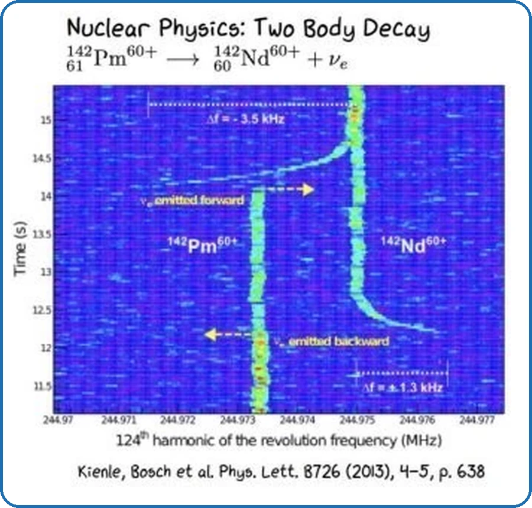
:::

:::rdecay {notes=off size=caption}
[^kienle]
:::

:::step {in=grow dur=0.4 after=0.5}
:::eht
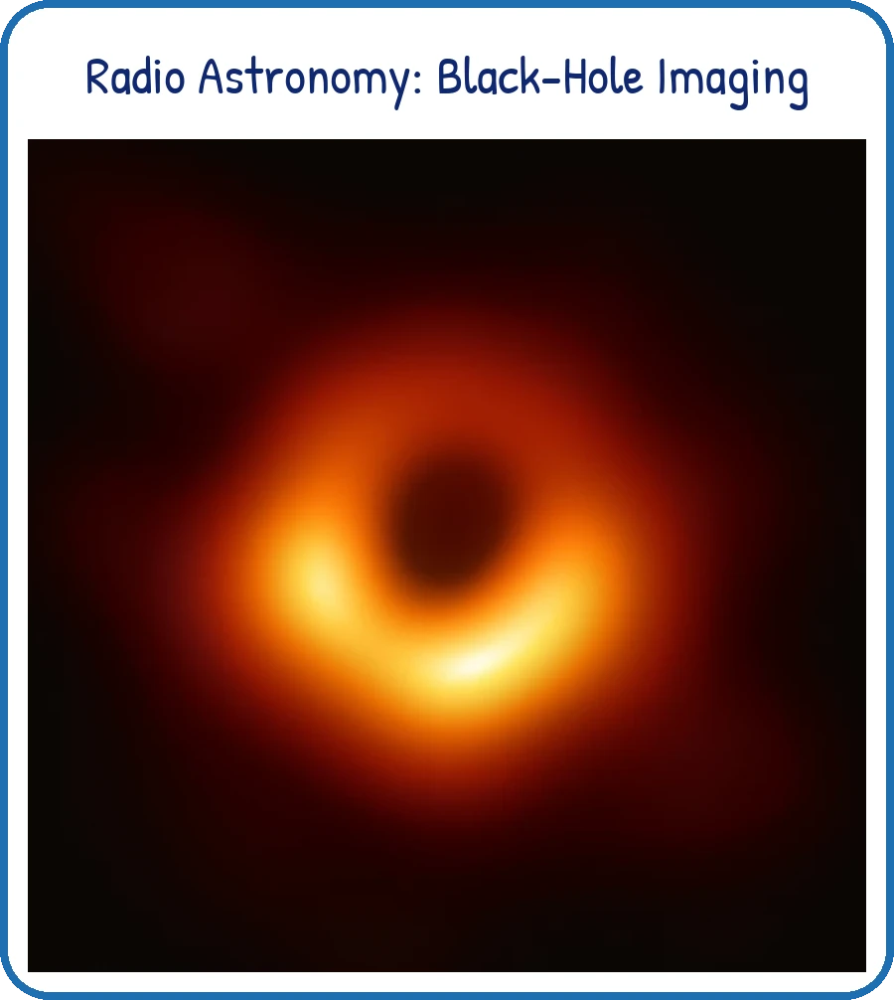
:::

:::reht {notes=off size=caption}
[^eht]
:::

:::step {in=grow dur=0.4 after=0.5}
:::chirp
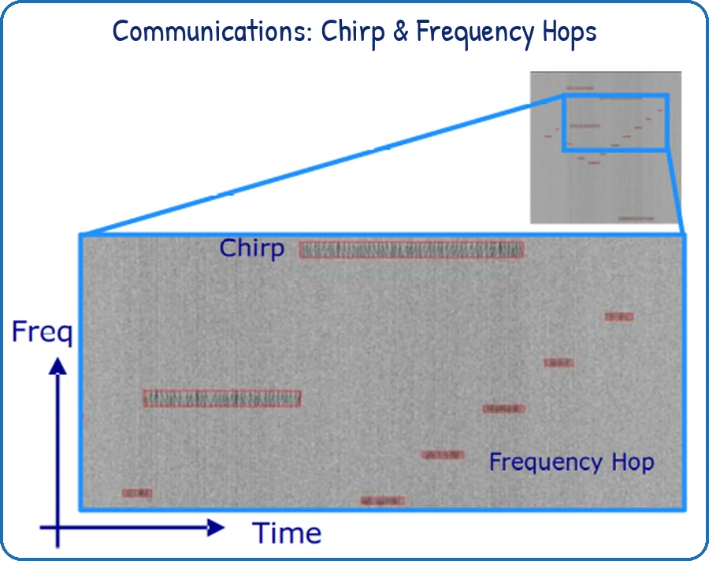
:::

:::rchirp {notes=off size=caption}
[^torchsig]
:::

:::step {in=grow dur=0.4 after=0.5}
:::schottky
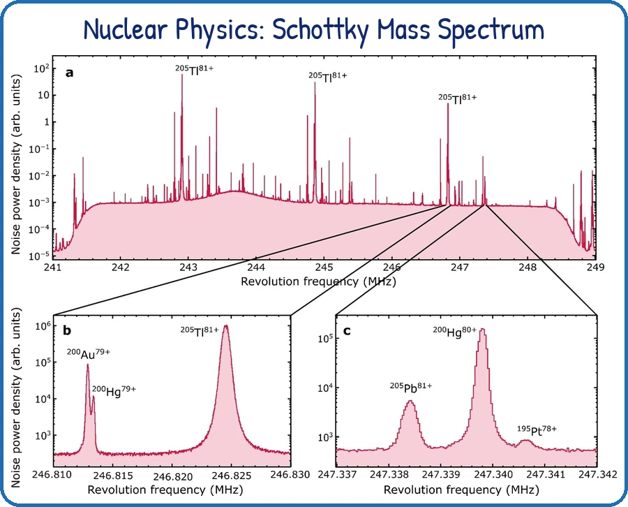
:::

:::rschottky {notes=off size=caption}
[^leckenby]
:::

:::step {in=grow dur=0.4 after=0.5}
:::radiography
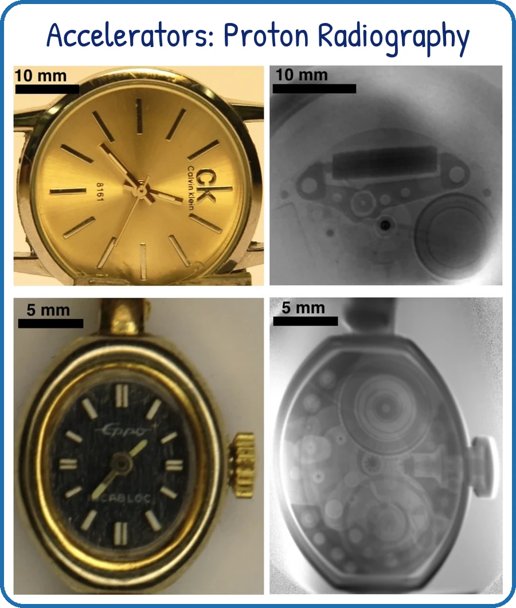
:::

:::rradiography {notes=off size=caption}
[^prior]
:::

:::step {in=grow dur=0.4 after=0.5}
:::phasespace
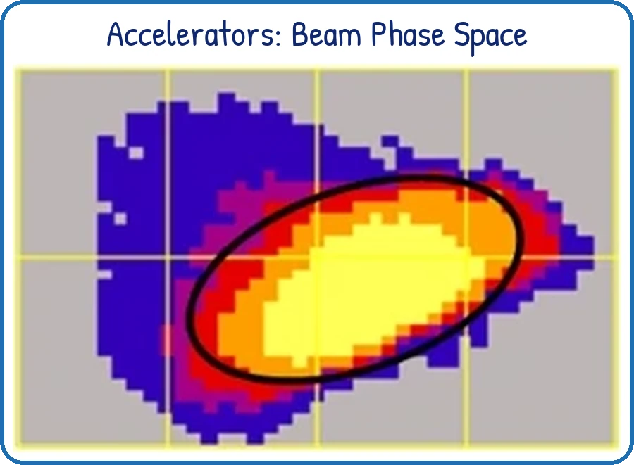
:::

:::rphasespace {notes=off size=caption}
[^groening]
:::

:::step {in=grow dur=0.4 after=0.5}
:::emitterid
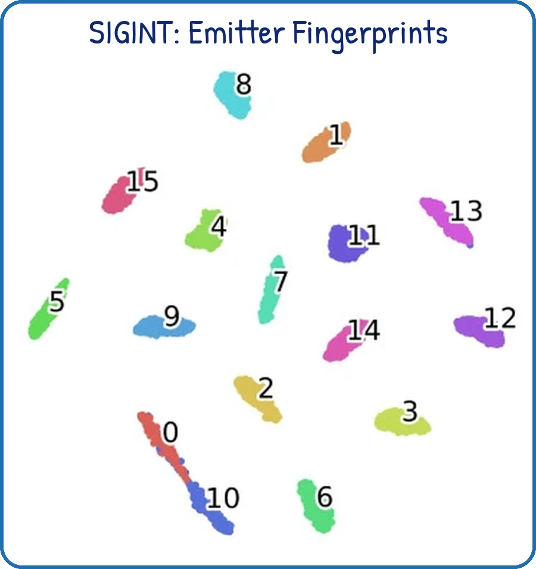
:::

:::remitterid {notes=off size=caption}
[^wang]
:::

:::step {in=grow dur=0.4 after=0.5}
:::rfi {bottom}
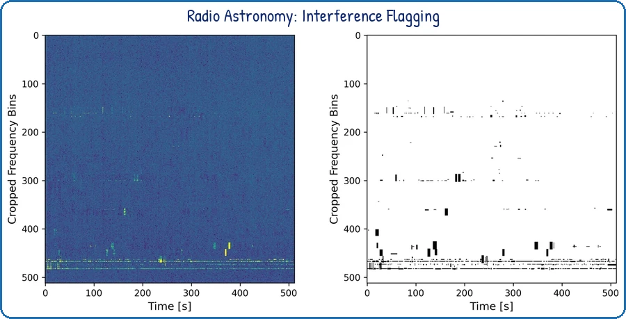
:::

:::rrfi {notes=off size=caption}
[^mesarcik]
:::

:::step {in=grow dur=0.4 after=0.5}
:::passiveradar
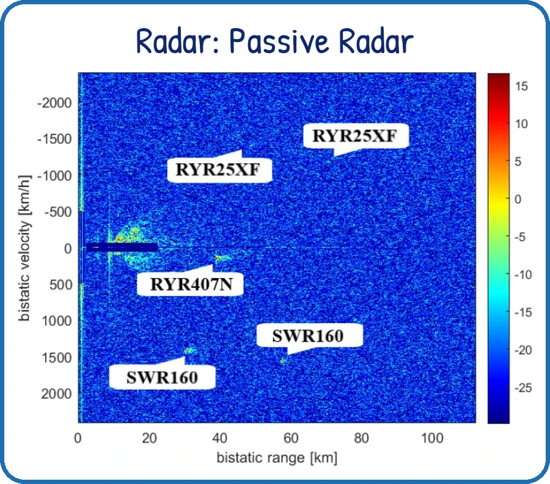
:::

:::rpassiveradar {notes=off size=caption}
[^klos]
:::

:::step {in=grow dur=0.4 after=0.5}
:::microdoppler
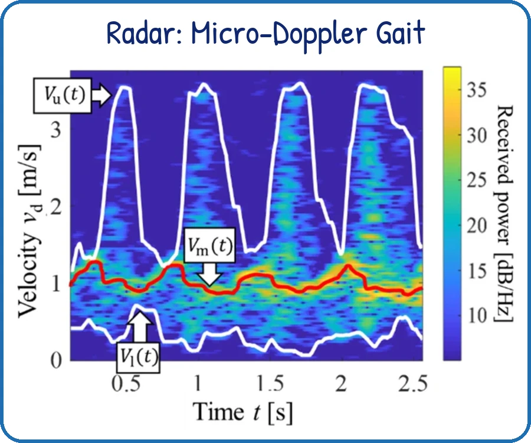
:::

:::rmicrodoppler {notes=off size=caption}
[^saho]
:::

:::notes
And then scale: sixteen devices, thirty-two harmonics, decimals — and in a real facility nobody hands you the list of devices.
So the target is online tracking of hundreds of, often unknown, devices: discover new signatures, track each one's normal and anomalous behaviour,
predict when it is likely to fail; the iRIS target is fifty-plus, proven in real conditions.
The open engineering: the GNU Radio 4 to ONNX pipeline, replay through the same graph, synchronising up to twelve sensor positions, and the training cost.
That is the research — and who we are looking for.

[click] And it is not only our puzzle: particle accelerators all across the world, beam phase spaces, radio, radio astronomy, radar — few projections, a strong prior, the same maths and the same tools.

:::

# {#questions master=title-logo}

:::layout
gremlin: figures/GREMLIN_logo_dark.svg
logo: media/gnuradiodays-2026-banner-cutout.webp
eu_flag_footer: figures/Flag_of_Europe.svg
fairgsi: figures/logos-dark.svg
transition: crt
duration: 1
:::

:::place
maintitle: 0.058 0.060 0.640 0.100
subline: 0.058 0.127 0.640 0.060
hiring: 0.202 0.868 0.600 0.060
contact: 0.057 0.934 0.750 0.066
mascots: 0.816 0.561 0.171 0.305
glitch: 0.850 0.859 0.060 0.050
bug: 0.932 0.859 0.050 0.050
:::

:::subline {size=20pt}
*real today: up to ~20 devices, one sensor*
:::

:::maintitle {size=27pt}
[Help us to catch …]{size=200%}
:::

:::hiring {size=142.5%}
[… join the team: [we are hiring two complementary positions](https://www.gsi.de/en/jobscareer/job_offers/initiativbewerbung)]{colour=#ffff00}
:::

:::contact {size=90%}
[**Questions? Let's talk …** · [https://fair-acc.github.io/gremlin/](https://fair-acc.github.io/gremlin/) · GNU Radio 4: [https://github.com/fair-acc/gnuradio4](https://github.com/fair-acc/gnuradio4) Funded by the European Union's Horizon Europe – Agreement No. 101275935 [(iRIS)](https://cordis.europa.eu/project/id/101275935) · slides: [doi:10.5281/zenodo.24059478](https://doi.org/10.5281/zenodo.24059478)]{colour=#ffff00}
:::

:::mascots

:::

:::glitch
[*Glitch*]{colour=#20b2aa}
:::

:::bug
[*Bug*]{colour=#32cd32}
:::

:::notes
That's GREMLIN: real today at small scale, grounded in physics you can benchmark, with a path to facility scale and high societal impact.

Help us to catch … GREMLINs: we are hiring two engineers — mathematicians, physicists, DSP or RF engineers with solid signal fundamentals and proven software skills,
each strong in at least one of high-performance real-time signal processing, RF measurement, or signal estimation and inverse problems — and with the curiosity to use ML as one tool among several.
The same methods protect hospital and blood-bank fridges. Full-time but flexible, up to two days a week from home, pay that holds its own against industry
— and room for the details and the fun that most industry jobs, driven by cost and sales, don't leave.
If this sounds like you, even if you don't tick every box, talk to me; the link on the slide is the formal route.

Questions?

(If asked about the team and the work: a relaxed, collegial team; the chance to take a project beyond 80/20 to 95 % and more; high direct societal impact; initially three years within iRIS, and I am keen to build up the department; English is the working language; childcare, visa support and relocation support from abroad. First missions: a hardware fault-injection bench for converters (phase errors and missing firing or gate pulses in thyristor and IGBT bridges), the GNU Radio 4 ↔ ONNX (the open exchange format for ML models) pipeline, time-series integration, disaggregation at 50+ devices. Background: fair-acc.github.io/gremlin. And Glitch and Bug — they are what we are hunting.)
:::

# References {#references master=blank}

:::place
cover: 0.020 0.654 0.800 0.340
:::

:::cover

:::

Every work the deck cites, numbered as on its slides.

:::references
qr: https://fair-acc.github.io/gremlin/
label: GREMLIN documentation
:::

[^ap]: A. Charlton and D.-A. Durbin, "Cyberattack targeting refrigeration systems hits 700 supermarkets, French government says," *AP*, Oct. 13, 2026. [ABC & AP](https://abcnews.com/amp/Business/wireStory/cyberattack-targeting-refrigeration-systems-hits-700-supermarkets-french-137230099)
[^certfr]: CERT-FR, "Incident de sécurité ciblant les contrôleurs à distance des installations de réfrigération," alert CERTFR-2026-ALE-012, Oct. 2026. [CERT-FR](https://cert.cyber.gouv.fr/alerte/CERTFR-2026-ALE-012/)
[^efs]: "Cyberattack on French blood bank fridges was thwarted before products and samples were damaged," *AP*, Nov. 4, 2026. [AP](https://www.nbcnews.com/world/france/france-cyberattack-blood-bank-refrigerators-samples-products-rcna607405)
[^iris]: J. Gutleber, A. Bottoni, Z. Aleksandra and P. Saba, "Socio-economic analysis of three use cases of AI powered electromagnetic interference analysis for sustainability applications," 2026. [Zenodo](https://doi.org/10.5281/zenodo.21399137)
[^kienle]: P. Kienle *et al.*, "High-resolution measurement of the time-modulated orbital electron capture and of the β+ decay of hydrogen-like 142Pm60+ ions," *Phys. Lett. B*, vol. 726, p. 638, 2013. [Elsevier](https://doi.org/10.1016/j.physletb.2013.09.033)
[^torchsig]: TorchSig: an open-source signal-processing machine-learning toolkit, TorchDSP. [GitHub](https://github.com/torchdsp/torchsig)
[^prior]: D. Varentsov *et al.*, "Commissioning of the PRIOR proton microscope," *Rev. Sci. Instrum.*, vol. 87, no. 2, Art. no. 023303, 2016. [ResearchGate](https://www.researchgate.net/publication/287249408_Commissioning_of_the_PRIOR_proton_microscope)
[^eht]: The EHT Collaboration *et al.*, "First M87 Event Horizon Telescope results. I. The shadow of the supermassive black hole," *Astrophys. J. Lett.*, vol. 875, Art. no. L1, 2019. [AAS](https://doi.org/10.3847/2041-8213/ab0ec7)
[^mesarcik]: M. Mesarcik *et al.*, "Learning to detect radio frequency interference in radio astronomy without seeing it," *Mon. Not. R. Astron. Soc.*, vol. 516, pp. 5367–5378, 2022. [OUP](https://doi.org/10.1093/mnras/stac2503)
[^klos]: J. Kłos *et al.*, "Experimental verification of the concept of using LOFAR radio-telescopes as receivers in passive radiolocation systems," *Sensors*, vol. 21, Art. no. 2043, 2021. [MDPI](https://doi.org/10.3390/s21062043)
[^saho]: K. Saho *et al.*, "Experimental verification of micro-Doppler radar measurements of fall-risk-related gait differences for community-dwelling elderly adults," *Sensors*, vol. 22, Art. no. 930, 2022. [MDPI](https://doi.org/10.3390/s22030930)
[^wang]: D. Wang *et al.*, "A self-supervised specific emitter identification method based on contrastive asymmetric masked learning," *Sensors*, vol. 25, Art. no. 4023, 2025. [MDPI](https://doi.org/10.3390/s25134023)
[^leckenby]: G. Leckenby *et al.*, "High-temperature 205Tl decay clarifies 205Pb dating in early Solar System," *Nature*, vol. 635, pp. 321–326, 2024. [Nature](https://doi.org/10.1038/s41586-024-08130-4)
[^groening]: L. Groening *et al.*, "Experimental proof of adjustable single-knob ion beam emittance partitioning," *Phys. Rev. Lett.*, vol. 113, Art. no. 264802, 2014. [APS](https://doi.org/10.1103/PhysRevLett.113.264802)
[^gupta]: S. Gupta, "ElectriSense: Single-point sensing using EMI for electrical event detection and classification," Ph.D. dissertation, Univ. Washington, 2014. [PhD thesis](http://hdl.handle.net/1773/26334)
[^boyer]: A. Boyer, H. Huang and S. Ben Dhia, "Impact of thermal aging on emission of a buck DC-DC converter," in *Proc. EMC'14/Tokyo*, 2014, pp. 77–80. [HAL](https://hal-univ-tlse3.archives-ouvertes.fr/hal-01006115)
[^kulkarni]: C. Kulkarni *et al.*, "Experimental studies of ageing in electrolytic capacitors," in *Proc. Annu. Conf. PHM Soc.*, 2010. [PHM Society](https://www.papers.phmsociety.org/index.php/phmconf/article/view/1727)
[^dimech]: E. Dimech and J. F. Dawson, "IGBT's ageing and its impacts on the EM conducted emissions," in *Proc. EMC Europe*, 2024. [White Rose](https://eprints.whiterose.ac.uk/212869)
[^valley]: J. Hensen and R. Loonen, "Using building simulation for moving innovations across the 'Valley of Death'," *REHVA J.*, vol. 52, no. 3, pp. 58–62, 2015. [REHVA](https://www.rehva.eu/rehva-journal/chapter/using-building-simulation-for-moving-innovations-across-the-valley-of-death)
[^nasa]: R. J. Terrile, F. G. Doumani, G. Y. Ho and B. L. Jackson, "Calibrating the technology readiness level (TRL) scale using NASA mission data," in *Proc. IEEE Aerospace Conf.*, 2015, pp. 1–9. [IEEE](https://doi.org/10.1109/AERO.2015.7119313)

# Backup — Experimental Setup at SIS18 [https://github.com/fair-acc/pulsed-power-ml](https://github.com/fair-acc/pulsed-power-ml) {#task-1}

:::place
photo_left: 0.013 0.150 0.235 0.682
caption_left: 0.023 0.816 0.215 0.041
photo_right: 0.696 0.150 0.298 0.695
caption_right: 0.706 0.819 0.278 0.065
centre_upper: 0.168 0.086 0.613 0.632
centre_lower: 0.254 0.686 0.443 0.178
:::

:::photo_left
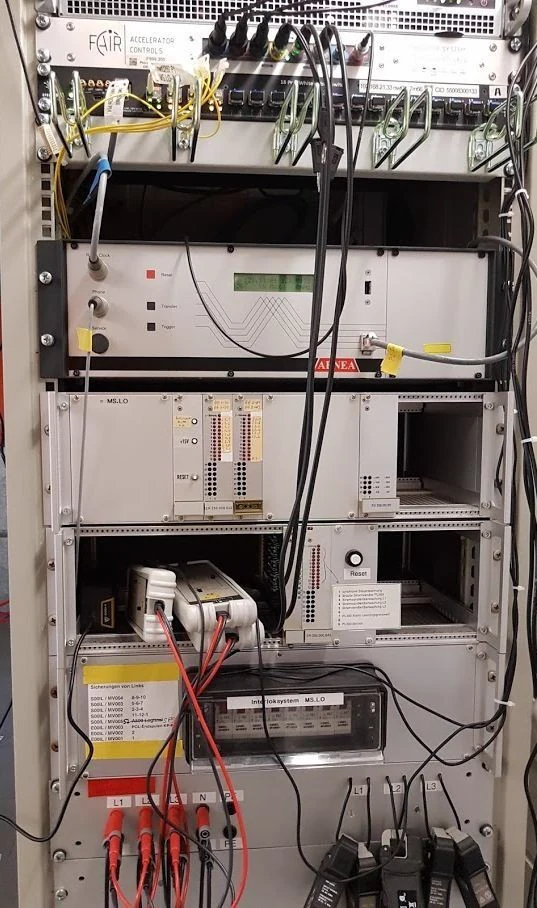
:::

:::caption_left {size=caption}
GSI/FAIR's 20kV mains feed test point
:::

:::photo_right
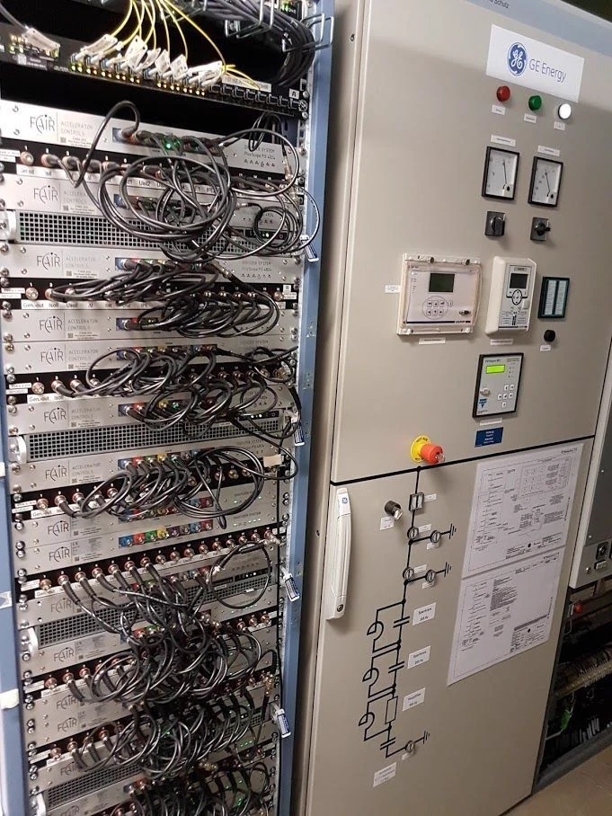
:::

:::caption_right {size=caption}
SIS18's and ESR's main dipole and quadrupole instrumentation
:::

:::centre_upper
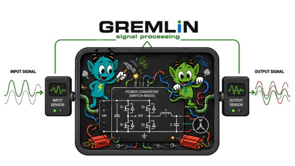
:::

:::centre_lower
**enables: classic system-design analysis** primary input↔secondary output

can validate: ML-model vs. known classic algorithms

**!! In real-world conditions !!**
:::

:::notes
This is where it lives: our 20 kV mains feed on the left, SIS18 and ESR's dipole and quadrupole instrumentation on the right. We instrument both ends of the box: the primary feed going in, and the secondary, the real magnet currents and fields, coming out. Classic system identification as ground truth; the input-plus-reflected-EMI as the GREMLIN signature; the classic path validates the EMI path. Most sites cannot afford both at once; an accelerator already has them.
:::

# Backup — electrical Network Compliance at FAIR [https://github.com/fair-acc/pulsed-power-ml](https://github.com/fair-acc/pulsed-power-ml) {#compliance}

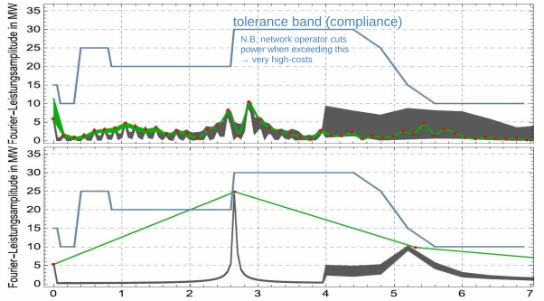

:::place
regs: 0.014 0.879 0.757 0.096
:::

:::regs
**GSI/FAIR needs to comply with electrical network power regulations** 
— the network operator cuts the power when the tolerance band is exceeded
:::

# Backup — Ageing changes RF/EMI fingerprints a known reliability effect in power semiconductors {#ageing}

:::layout
plot: media/igbt-ageing-emissions.webp
:::

:::place
plot: 0.202 0.146 0.596 0.661
text: 0.036 0.812 0.750 0.075
:::

:::text {notes=off}
- can be exploited – **key questions: false-positive & false-negative detection rates** — seen for buck DC-DC converters[^boyer], electrolytic capacitors[^kulkarni] and IGBTs (the figure)[^dimech]
:::

# Backup — GREMLIN deliverables within iRIS [https://fair-acc.github.io/gremlin/](https://fair-acc.github.io/gremlin/) (not necessarily in order) {#deliverables master=double}

:::layout
size: 80%
:::

**I.** Pulsed-Power PoC → TRL 6-7-ready Open-Hardware Documentation → setup reproducible across labs/industries

- [https://github.com/fair-acc/pulsed-power-ml](https://github.com/fair-acc/pulsed-power-ml)
- [https://github.com/fair-acc/gremlin](https://github.com/fair-acc/gremlin)

**II.** GNU Radio 4 ↔ ONNX Integration portable model exchange between labs and deployment targets

- GR4: [https://github.com/fair-acc/gnuradio4](https://github.com/fair-acc/gnuradio4)
- DAQ integration: [https://github.com/fair-acc/gr-digitizers](https://github.com/fair-acc/gr-digitizers)
- OpenDigitizer UI/UX: [https://github.com/fair-acc/opendigitizer](https://github.com/fair-acc/opendigitizer)
- GREMLIN documentation: [https://github.com/fair-acc/gremlin](https://github.com/fair-acc/gremlin) *N.B. ML ONNX integration is generic, parties need to contact GSI/FAIR for specific weights (compliance requirement)*

**III.** GR4-Time-Series-DB Integration (VictoriaMetrics, tbc)

**IV.** model training, anomaly-detection heads, and evaluation some technical risks but manageable:

- model training complexity
- required compute time → 3 months of HPC compute reserved
- worst case: destructive testing

**V.** Open Public Demonstration

:::place
grlogo: 0.625 0.016 0.275 0.100
badge: 0.906 0.043 0.087 0.071
:::

:::grlogo

:::

:::badge

:::

:::right
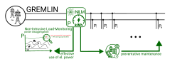

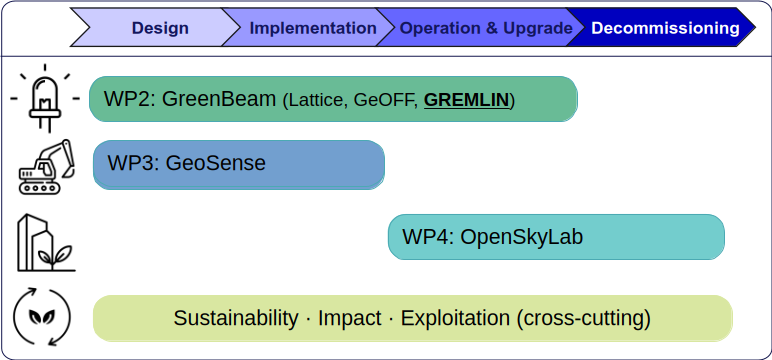
:::

# Backup — Quadrupling of Costs for moving from TRL 5 → TRL 6 → TRL 7 {#trl-costs master=double}

:::right
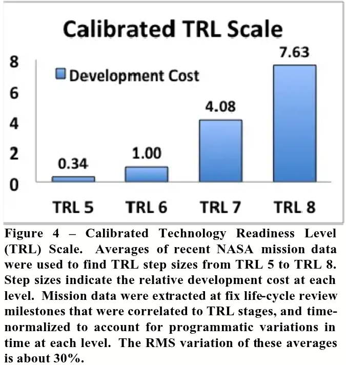
:::

:::place
valley: 0.025 0.146 0.471 0.737
badge_left: 0.169 0.199 0.198 0.099
badge: 0.845 0.143 0.157 0.143
:::

:::valley {notes=off size=80%}
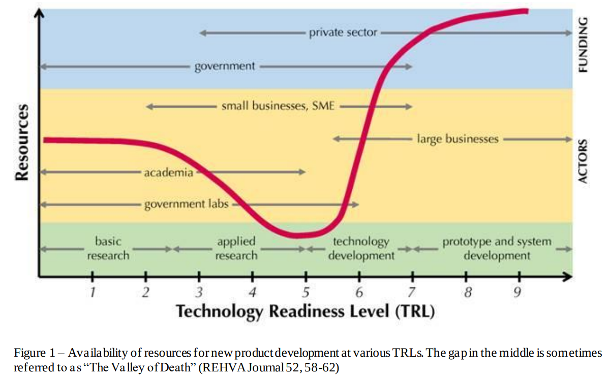

[Figures: the "valley of death" of resources across TRLs[^valley]; NASA's calibrated TRL scale[^nasa].]{size=caption}
:::

:::badge_left

:::

:::badge

:::

